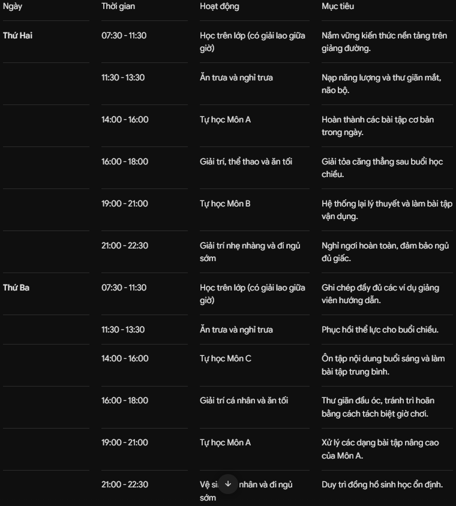
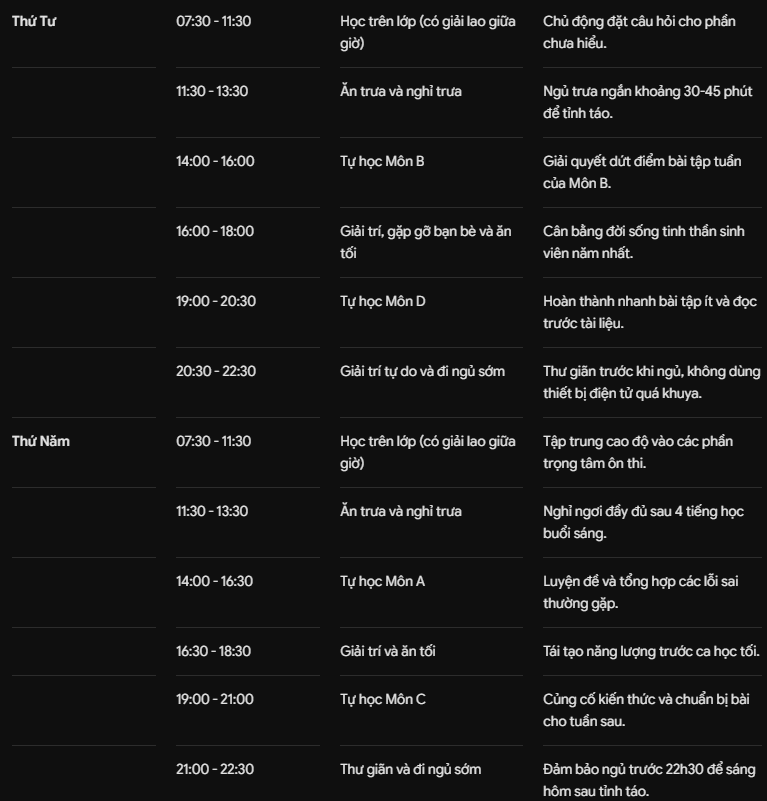
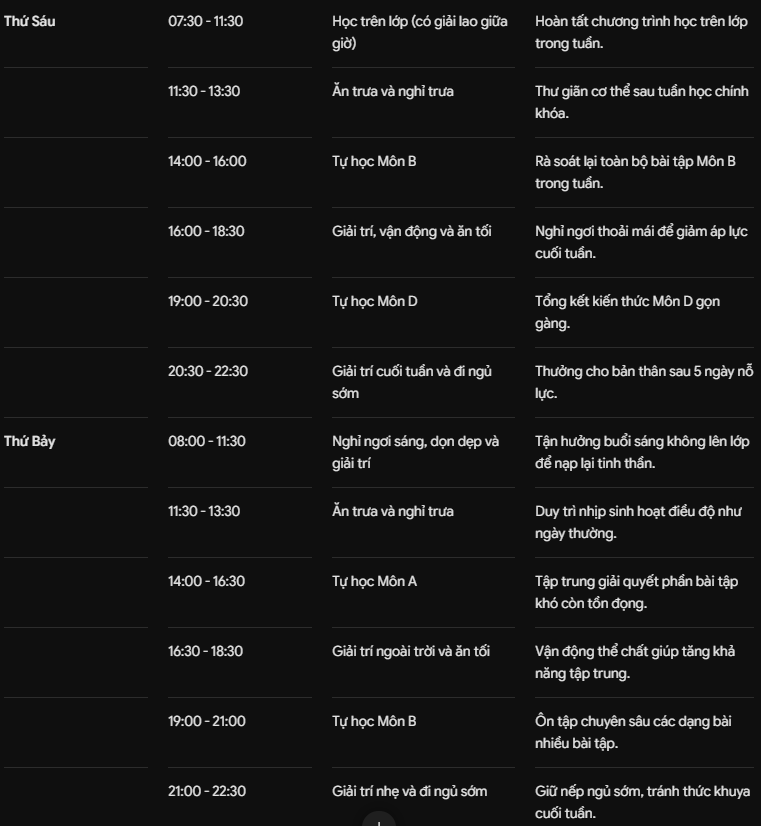
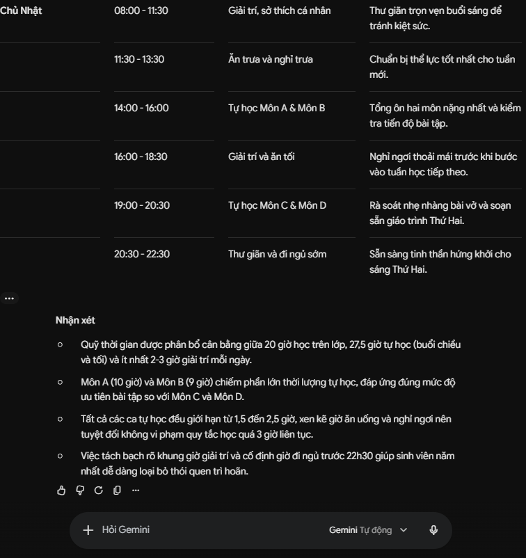

## Viết Promp CREATE: 

**CONTEXT**:

Bạn là cố vấn học tập có kinh nghiệm hướng dẫn sinh viên năm nhất. Mình là sinh viên năm nhất, thường xuyên trì hoãn việc học và chưa biết cách phân bổ thời gian giữa học trên lớp, tự học và giải trí.

**REQUEST**:

Hãy phân tích quỹ thời gian của tôi và xây dựng kế hoạch học tập chi tiết cho 7 ngày (Thứ Hai đến Chủ Nhật).

**EXPLANATION:**

Ràng buộc:

- Tôi học trên lớp từ Thứ Hai đến Thứ Sáu, mỗi ngày từ 7h30 đến 11h30 (có thể có giải lao giữa giờ).

- Thứ Bảy và Chủ Nhật không có giờ trên lớp.

- Thời gian tự học chỉ được xếp vào buổi chiều và buổi tối.

- Mỗi ngày (cả 7 ngày) phải có ít nhất 1 giờ giải trí.

- Không xếp học liên tục quá 3 giờ, giữa các đợt học phải có thời gian nghỉ.

- Kế hoạch phải có giờ ăn, nghỉ trưa và đi ngủ sớm.

- Các môn của tôi: Môn A (nhiều bài tập nhất), Môn B (nhiều bài tập), Môn C (trung bình), Môn D (ít bài tập). KHÔNG tự bịa thêm môn học.

- Ưu tiên dành nhiều thời gian tự học hơn cho các môn có nhiều bài tập.

**ACTION:**

Thực hiện lần lượt:

1. Phân tích quỹ thời gian: giờ học lớp, giờ tự học khả dụng, giờ giải trí, giờ nghỉ.

2. Chia khung giờ cho từng ngày theo đúng ràng buộc.

3. Phân bổ môn tự học, ưu tiên Môn A và Môn B.

4. Kiểm tra lại: có ngày nào học quá 3 giờ liên tục không, có ngày nào thiếu 1 giờ giải trí không.

5. Viết nhận xét ngắn về tính hợp lý của kế hoạch.

**TONE:**

Rõ ràng, thực tế, động viên nhẹ nhàng, phù hợp với sinh viên năm nhất. Không chào hỏi dạo đầu.

**EXTRAS:**

Định dạng đầu ra:

1. Một Bảng Markdown gồm 4 cột đúng tên: [Ngày], [Thời gian], [Hoạt động], [Mục tiêu], đủ 7 ngày.

2. Sau bảng là phần "Nhận xét" gồm 3-5 gạch đầu dòng ngắn, mỗi gạch tối đa 1 câu.

3. KHÔNG trình bày dưới dạng đoạn văn dài.

## Gemini trả lời:

